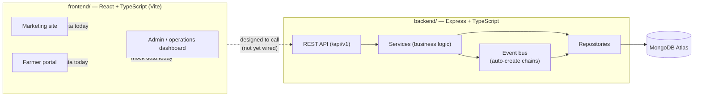

# KeepXtra

**Powering Africa's fresh produce supply chain.**

KeepXtra is technology-driven logistics infrastructure that reduces post-harvest food loss — connecting farmers to cold storage, quality assurance, and delivery for restaurants, hotels, retailers, and households.

This repository is a monorepo containing the public marketing site, the farmer and admin portals, and the backend API that powers them.

> **Status:** the backend API is feature-complete across all 10 business modules (auth through reporting). The frontend currently runs on an in-memory mock data layer and is not yet wired to the live API — see [Roadmap](#roadmap).

---

## Table of contents

- [Architecture](#architecture)
- [Tech stack](#tech-stack)
- [Repository structure](#repository-structure)
- [Frontend setup](#frontend-setup)
- [Backend setup](#backend-setup)
- [Environment variables](#environment-variables)
- [Deployment](#deployment)
- [API documentation](#api-documentation)
- [Screenshots](#screenshots)
- [Roadmap](#roadmap)
- [License](#license)

---

## Architecture



The backend follows a strict layered architecture — `Routes → Validators → Controllers → Services → Repositories → MongoDB` — with an event bus driving auto-creation between modules (e.g. an approved Storage Request spawns a Pickup, a completed Pickup spawns an Inventory record). Every mutating endpoint is gated by role-based permissions and writes an audit-log entry. Full design detail: [docs/architecture](docs/architecture/BACKEND_ARCHITECTURE.md).

## Tech stack

| | |
|---|---|
| **Frontend** | React 19, TypeScript, Vite, React Router, Tailwind CSS, TanStack Query, React Hook Form + Zod, Framer Motion, Recharts |
| **Backend** | Node.js, Express, TypeScript, MongoDB + Mongoose, JWT auth, Zod validation, Swagger/OpenAPI, Vitest |
| **Tooling** | oxlint (frontend), ESLint (backend), Prettier, GitHub Actions CI |

## Repository structure

```
KeepXtra/
├── frontend/     React + Vite app — marketing site, farmer portal, admin dashboard
├── backend/      Express API — auth, farmers, storage, fleet, sales, payments, reports, ...
├── docs/         Architecture, deployment, API, database, security, developer guide
├── pitch-deck/   Standalone script that generates the investor pitch-deck PDF
└── .github/      CI workflows
```

See [docs/developer-guide](docs/developer-guide/README.md) for the full breakdown of each app's internal structure.

## Frontend setup

```bash
cd frontend
npm install
npm run dev       # http://localhost:5173
```

Details: [frontend/README.md](frontend/README.md).

## Backend setup

```bash
cd backend
npm install
cp .env.example .env    # fill in real values, see below
npm run dev              # http://localhost:4000
```

Run the test suite with `npm test` (uses a disposable in-memory MongoDB — no real database required).

## Environment variables

The backend is configured entirely through environment variables — see `backend/.env.example` for the full list (Mongo connection string, JWT secrets, CORS origin, etc.) and [docs/security](docs/security/README.md) for what each secret protects. **Never commit a populated `.env` file.**

## Deployment

Frontend and backend deploy independently — the frontend is a static build servable from any CDN/static host, the backend is a standard Node.js service. Full instructions: [docs/deployment](docs/deployment/README.md).

## API documentation

The backend serves live, interactive API docs once running:

- Swagger UI: `http://localhost:4000/docs`
- Raw OpenAPI spec: `http://localhost:4000/docs.json`

Conventions, auth, and module overview: [docs/api](docs/api/README.md).

## Screenshots

_Not yet added — coming soon._

## Roadmap

- Wire the frontend's `authService` / `farmerService` / `adminService` to the real backend API, replacing the current mock data layer
- Containerize both apps (Dockerfile + docker-compose) for local and production parity
- Frontend automated test suite
- Real-world payment gateway integration behind the existing Payments module

## License

[MIT](LICENSE)
