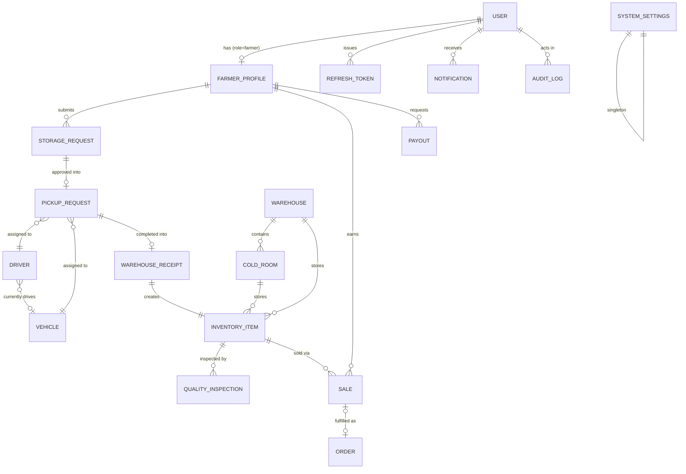

# KeepXtra Backend — Software Architecture Document (SAD)

**Status:** Architecture only — no implementation exists yet.
**Audience:** Backend engineering team implementing the Node.js/Express/MongoDB service that will replace `src/services/mock/*` behind the existing `authService`, `farmerService`, and `adminService` frontend contracts.
**Stack:** Node.js, Express.js, TypeScript, MongoDB Atlas, Mongoose, JWT, Cloudinary, Redis (future).

## 0. How to read this document

The frontend at `src/` is fully built against three service modules — `authService.ts`, `farmerService.ts`, `adminService.ts` — that currently return `structuredClone`d mock data through `simulateRequest`/`simulateMutation` (see `src/services/simulateRequest.ts`). Every function signature in those three files is a **contract already agreed with the frontend**. This document reverse-engineers the backend that must satisfy those contracts, then extends it with the auth, security, and operational machinery a real deployment needs.

Where the current frontend mock is thinner than a production system requires (e.g. no password on `registerFarmer`, no refresh tokens, no Order↔Sale linkage), this is called out explicitly as an **Architecture Decision** so the implementing engineer knows it's an intentional extension, not a misreading of the frontend.

---

## STEP 1 — Business Domain Analysis

| Entity | Purpose |
|---|---|
| **User** | Root identity/auth record for every human who can log in — farmers and every internal operations role. Holds credentials, not business data. |
| **FarmerProfile** | The farming-business extension of a `User` with `role: farmer` — farm location, payout method/account, cached earnings/produce totals. |
| **Role / Permission** | The operations RBAC model (`Operations`, `Warehouse Staff`, `Driver`, `Finance`, `Manager`, `Super Admin`) and the granular permission strings each role grants, mirroring `src/types/permissions.ts`. |
| **RefreshToken** | Server-side record of an issued refresh token (rotation, revocation, device/session tracking). Not user-facing. |
| **PasswordResetToken** | Single-use, short-lived token issued for the forgot-password flow. |
| **Warehouse** | A physical cold-storage facility: address, aggregate capacity/occupancy, temperature telemetry. Owns one or more Cold Rooms. |
| **ColdRoom** | A temperature-controlled room inside a Warehouse — its own capacity, occupancy, operational status, last inspection date. |
| **StorageBin** | The smallest storage unit inside a Cold Room (a shelf/pallet slot code) that an `InventoryItem` is physically placed in. |
| **StorageRequest** | A farmer's request to store a harvested crop — the entry point of the produce lifecycle, reviewed by Operations. |
| **PickupRequest** | The logistics record created once a `StorageRequest` is approved — tracks driver/vehicle assignment and physical collection status. |
| **Driver** | A KeepXtra collection driver — license, phone, performance rating, current availability, assigned vehicle. |
| **Vehicle (Fleet)** | A collection vehicle — plate, type, maintenance/health/fuel status, current assignment. |
| **WarehouseReceipt** | The immutable record of produce physically arriving and being logged into a Warehouse/ColdRoom/Bin — the event that creates an `InventoryItem`. |
| **InventoryItem** | A specific quantity of a specific crop, from a specific farmer, sitting in cold storage — the central operational entity most other records key off. |
| **QualityInspection** | The graded outcome (Approved / Rejected / Partial Acceptance) of inspecting an `InventoryItem` after receiving. |
| **Order** | The buyer-facing fulfillment record (who's buying, what, delivery pipeline status) — the logistics/delivery view of a transaction. |
| **Sale** | The financial record of an `InventoryItem` (or portion of it) being sold — selling price, KeepXtra commission, farmer's net earnings, invoice, payment status. |
| **Payout** | A farmer's request (or system-issued disbursement) to withdraw their earned balance — reviewed, approved, and processed by Finance. |
| **Notification** | An in-app message pushed to a specific user (today: the farmer) about something that changed — categorized (Inventory/Sales/Payments/Pickups/System/Warnings/Alerts). |
| **ActivityEvent** | A lightweight, human-readable timeline entry ("what just happened") shown on dashboards — a narrower, UX-facing sibling of the Audit Log. |
| **AuditLogEntry** | The compliance-grade record of *who* changed *what*, *from* what value *to* what value, *when* — required for every state-changing mutation in the system. |
| **SystemSettings** | Singleton (or company-scoped) configuration: company profile, pickup rules, storage fee rates, payment/commission settings, notification defaults. |
| **RevenueTrendPoint / SalesTrendPoint / StorageUtilizationPoint** | Precomputed/aggregated analytics read-models (see §10 on materialized reporting) that back the dashboard and Analytics page charts. |

---

## STEP 2 — Database Design

Conventions applied to **every** collection unless stated otherwise:

- **Audit fields:** `createdAt`, `updatedAt` (Mongoose `timestamps: true`), `createdBy` / `updatedBy` (`ObjectId → User`, nullable for system-generated writes).
- **Soft delete:** `deletedAt: Date | null` + `isDeleted: boolean` (indexed). No document is ever hard-deleted from a business collection; all repository queries default-filter `isDeleted: false`. Hard deletes are reserved for `RefreshToken`/`PasswordResetToken` (via TTL index) and hard-GDPR-erasure requests, which are handled as an explicit, audited exception.
- **IDs:** Mongo `_id` (ObjectId) is the canonical ID. The frontend's mock `id` strings (e.g. `far-001`, `inv-002`) map 1:1 to `_id.toString()` — no separate human ID field is required unless a human-readable reference is explicitly needed (invoices use one, see `Sale.invoiceId`).
- **Money fields** are stored as **integers in minor units (pesewas)**, never floats, to avoid rounding drift; the API layer converts to/from major units (GHS) at the edge.

### 2.1 `users`

**Purpose:** Root authentication identity for every login-capable actor (farmer or internal staff).

| Field | Type | Required | Notes |
|---|---|---|---|
| `_id` | ObjectId | yes | |
| `name` | string | yes | |
| `email` | string | yes | unique, lowercased, trimmed |
| `passwordHash` | string | yes | bcrypt/argon2id hash, never returned by any query projection |
| `role` | enum(`farmer`,`admin`) | yes | top-level auth role — matches `UserRole` in `src/types/auth.ts` |
| `operationsRole` | enum(`Operations`,`Warehouse Staff`,`Driver`,`Finance`,`Manager`,`Super Admin`) | only if `role=admin` | drives `ROLE_PERMISSIONS` from `src/types/permissions.ts` |
| `avatarInitials` | string | yes | derived at creation, cached for fast list rendering |
| `phone` | string | yes | |
| `status` | enum(`Active`,`Suspended`,`Pending Review`) | yes | farmers start `Pending Review`; matches `FarmerAccountStatus` |
| `emailVerifiedAt` | Date \| null | no | |
| `lastLoginAt` | Date \| null | no | |
| `passwordChangedAt` | Date \| null | no | used to invalidate tokens issued before a password change |
| `isDeleted` / `deletedAt` | bool / Date | — | soft delete |
| `createdAt` / `updatedAt` | Date | — | |

**Indexes:** `{ email: 1 }` unique; `{ role: 1, status: 1 }`; `{ isDeleted: 1 }`.
**Validation:** email regex + uniqueness (case-insensitive collation); `operationsRole` required-if `role === 'admin'` (Mongoose custom validator); password never accepted directly — only `passwordHash` is written, by the auth service after hashing.
**Relationships:** 1:1 → `farmer_profiles` (when `role=farmer`); 1:N → every collection's `createdBy`/`updatedBy`; 1:N → `refresh_tokens`.

```json
{
  "_id": "665f1a2b3c4d5e6f7a8b9c0d",
  "name": "Kwame Asante",
  "email": "farmer@keepxtra.com",
  "passwordHash": "$argon2id$v=19$...",
  "role": "farmer",
  "avatarInitials": "KA",
  "phone": "+233 24 000 0000",
  "status": "Active",
  "emailVerifiedAt": "2026-01-14T09:02:11.000Z",
  "lastLoginAt": "2026-08-04T07:31:02.000Z",
  "isDeleted": false,
  "createdAt": "2026-01-10T12:00:00.000Z",
  "updatedAt": "2026-08-04T07:31:02.000Z"
}
```

### 2.2 `farmer_profiles`

**Purpose:** The business-facing extension of a farmer `User` — everything `adminService.getFarmers()` and `farmerService.getProfile()` need beyond identity.

| Field | Type | Required | Notes |
|---|---|---|---|
| `_id` | ObjectId | yes | |
| `userId` | ObjectId → `users` | yes, unique | 1:1 owner |
| `farmLocation` | string | yes | |
| `preferredPayoutMethod` | string | yes | e.g. "Mobile Money" |
| `payoutAccountNumber` | string | yes | encrypted at rest (see §9) |
| `totalProduceKg` | number | yes, default 0 | cached aggregate, recalculated transactionally on receiving/sale events |
| `totalEarningsMinor` | number | yes, default 0 | cached aggregate (pesewas), recalculated on `Sale` creation |
| `isDeleted` / `deletedAt` | bool / Date | — | |
| `createdAt` / `updatedAt` | Date | — | `createdAt` doubles as the frontend's `joinedAt` |

**Indexes:** `{ userId: 1 }` unique; `{ farmLocation: 1 }` (list filtering); text index on a denormalized `name` copy is intentionally **avoided** — search joins to `users.name` via `$lookup` or, at scale, an Atlas Search index spanning both collections (see §10).
**Validation:** `payoutAccountNumber` format validated per `preferredPayoutMethod` (mobile money vs bank).
**Relationships:** 1:1 ← `users`; 1:N → `storage_requests`, `pickup_requests`, `inventory_items`, `sales`, `payouts`, `notifications` (all via the farmer's `userId`, not this collection's `_id`, to keep foreign keys stable even if the profile document is ever rebuilt).

### 2.3 `refresh_tokens`

**Purpose:** Server-side allow-list backing refresh-token rotation (see §5).

| Field | Type | Required | Notes |
|---|---|---|---|
| `_id` | ObjectId | yes | |
| `userId` | ObjectId → `users` | yes | |
| `tokenHash` | string | yes | SHA-256 of the raw refresh token; raw value is **never** stored |
| `family` | string (uuid) | yes | rotation family id — reused across a refresh chain, rotated as a whole on reuse detection |
| `expiresAt` | Date | yes | TTL-indexed |
| `revokedAt` | Date \| null | no | |
| `replacedByTokenHash` | string \| null | no | rotation chain pointer |
| `userAgent`, `ip` | string | no | forensic/session metadata |

**Indexes:** `{ tokenHash: 1 }` unique; `{ userId: 1, revokedAt: 1 }`; `{ expiresAt: 1 }` **TTL index** (`expireAfterSeconds: 0`) — Mongo auto-purges expired tokens.
**Soft delete:** not applicable — this collection is designed for hard expiry via TTL.

### 2.4 `password_reset_tokens`

| Field | Type | Required | Notes |
|---|---|---|---|
| `_id` | ObjectId | yes | |
| `userId` | ObjectId → `users` | yes | |
| `tokenHash` | string | yes | SHA-256 of raw token sent by email |
| `expiresAt` | Date | yes | TTL index, 30–60 min |
| `usedAt` | Date \| null | no | single-use enforcement |

**Indexes:** `{ tokenHash: 1 }` unique; `{ expiresAt: 1 }` TTL.

### 2.5 `warehouses`

**Purpose:** A physical cold-storage facility. Mirrors `WarehouseRecord` in `src/types/admin.ts`.

| Field | Type | Required | Notes |
|---|---|---|---|
| `_id` | ObjectId | yes | |
| `name` | string | yes | unique |
| `code` | string | yes | unique, short (e.g. `WH-ACC-01`) |
| `address` | string | yes | |
| `location` | string | yes | region/city label used for grouping |
| `coldRoomCapacityKg` | number | yes | denormalized sum of `coldRooms[].capacityKg`, kept in sync on write |
| `currentOccupancyKg` | number | yes, default 0 | denormalized sum of `coldRooms[].occupancyKg` |
| `temperatureC` | number | yes | facility-level ambient reading |
| `lastLoggedAt` | Date | yes | last telemetry update |
| `coldRooms` | ColdRoom[] (embedded) | yes | see below |
| `isDeleted` / `deletedAt` | bool / Date | — | |
| `createdAt` / `updatedAt` | Date | — | |

**Embedded sub-document — `ColdRoom`** (bounded array, typically 1–4 per warehouse, embedded rather than referenced since it's never queried independently of its warehouse):

| Field | Type | Required | Notes |
|---|---|---|---|
| `_id` | ObjectId | yes | subdocument id, used as `coldRoom` reference elsewhere |
| `name` | string | yes | e.g. "Cold Room A" |
| `temperatureC` | number | yes | |
| `capacityKg` | number | yes | |
| `occupancyKg` | number | yes, default 0 | |
| `status` | enum(`Operational`,`Under Maintenance`,`Offline`) | yes | |
| `lastInspectionDate` | Date | yes | |
| `bins` | string[] | no | storage-bin codes available inside this room (Phase 2: promote to full `{code, capacityKg, occupancyKg}` objects once per-bin capacity tracking is needed — current frontend only needs a bin **code** at receiving time) |

**Indexes:** `{ code: 1 }` unique; `{ name: 1 }` unique; `{ 'coldRooms._id': 1 }` (lookups from `InventoryItem.coldRoomId`); `{ isDeleted: 1 }`.
**Validation:** `occupancyKg <= capacityKg` at both warehouse and cold-room level, enforced in the service layer (not the schema, since it's a cross-write invariant maintained transactionally on receiving/dispatch).
**Relationships:** 1:N → `inventory_items` (via `warehouseId` + `coldRoomId`); referenced by `pickup_requests`/`warehouse_receipts` at receiving time.

```json
{
  "_id": "66a0...",
  "name": "Accra Cold Hub",
  "code": "WH-ACC-01",
  "address": "12 Spintex Road, Accra",
  "location": "Greater Accra",
  "coldRoomCapacityKg": 18000,
  "currentOccupancyKg": 11450,
  "temperatureC": 4,
  "lastLoggedAt": "2026-08-04T06:00:00.000Z",
  "coldRooms": [
    {
      "_id": "66a0...cr1",
      "name": "Cold Room A",
      "temperatureC": 3,
      "capacityKg": 10000,
      "occupancyKg": 7200,
      "status": "Operational",
      "lastInspectionDate": "2026-07-28T00:00:00.000Z",
      "bins": ["A-01", "A-02", "A-03"]
    }
  ]
}
```

### 2.6 `storage_requests`

**Purpose:** Farmer-initiated request to store a harvest. Mirrors `AdminStorageRequest`/`StorageRequest`.

| Field | Type | Required | Notes |
|---|---|---|---|
| `_id` | ObjectId | yes | |
| `farmerId` | ObjectId → `users` | yes | |
| `crop` | string | yes | |
| `quantityKg` | number | yes | > 0 |
| `harvestDate` | Date | yes | |
| `pickupLocation` | string | yes | |
| `preferredPickupDate` | Date | yes | |
| `notes` | string | no | |
| `status` | enum(`Pending`,`Approved`,`Rejected`,`Info Requested`) | yes, default `Pending` | |
| `reviewNotes` | string | no | rejection reason / info-request message |
| `reviewedBy` | ObjectId → `users` | no | |
| `linkedPickupRequestId` | ObjectId → `pickup_requests` | no | set on approval |
| `isDeleted` / `deletedAt`, `createdAt`/`updatedAt`, `createdBy`/`updatedBy` | — | — | standard |

**Indexes:** `{ farmerId: 1, status: 1 }`; `{ status: 1, createdAt: -1 }` (Operations queue); `{ isDeleted: 1 }`.
**Validation:** `quantityKg > 0`; `preferredPickupDate >= harvestDate`.
**Relationships:** N:1 → farmer; 1:1 → `pickup_requests` (once approved).

### 2.7 `pickup_requests`

**Purpose:** Logistics record for physically collecting an approved storage request. Mirrors `AdminPickupRequest`.

| Field | Type | Required | Notes |
|---|---|---|---|
| `_id` | ObjectId | yes | |
| `storageRequestId` | ObjectId → `storage_requests` | yes | |
| `farmerId` | ObjectId → `users` | yes | denormalized for direct farmer-scoped queries |
| `crop` | string | yes | denormalized from the storage request at creation time (immutable snapshot) |
| `quantityKg` | number | yes | |
| `pickupLocation` | string | yes | |
| `preferredPickupDate` | Date | yes | |
| `pickupDate` | Date | no | set on driver assignment |
| `status` | enum(`Pending`,`Approved`,`Driver Assigned`,`Driver En Route`,`Collected`,`Delivered to Warehouse`,`Completed`) | yes, default `Pending` | matches `PickupStatus` |
| `driverId` | ObjectId → `drivers` | no | |
| `vehicleId` | ObjectId → `vehicles` | no | |
| `notes` | string | no | |
| standard audit/soft-delete fields | | | |

**Indexes:** `{ farmerId: 1, status: 1 }`; `{ status: 1, pickupDate: 1 }` (dispatch board); `{ driverId: 1, status: 1 }`; `{ storageRequestId: 1 }` unique.
**Relationships:** 1:1 ← `storage_requests`; N:1 → `drivers`, `vehicles`; 1:1 → `warehouse_receipts` (on completion).

### 2.8 `drivers`

**Purpose:** KeepXtra collection driver roster. Mirrors `Driver` (`src/types/driver.ts`).

| Field | Type | Required | Notes |
|---|---|---|---|
| `_id` | ObjectId | yes | |
| `userId` | ObjectId → `users` | no | set once drivers get their own login (Phase 2); today drivers are staff records without portal access |
| `name` | string | yes | |
| `avatarInitials` | string | yes | |
| `licenseNumber` | string | yes, unique | |
| `phone` | string | yes | |
| `assignedVehicleId` | ObjectId → `vehicles` | no | |
| `todaysDeliveries` | number | yes, default 0 | rolled up nightly (see §8 jobs) |
| `completedDeliveries` | number | yes, default 0 | lifetime counter, incremented transactionally |
| `performanceRating` | number (1–5) | yes, default 5 | |
| `availability` | enum(`Available`,`On Delivery`,`Off Duty`) | yes, default `Available` | |
| standard audit/soft-delete fields | | | |

**Indexes:** `{ licenseNumber: 1 }` unique; `{ availability: 1 }`.
**Relationships:** 1:N ← `pickup_requests`; N:1 → `vehicles` (current assignment).

### 2.9 `vehicles`

**Purpose:** Fleet asset roster. Mirrors `FleetVehicle`.

| Field | Type | Required | Notes |
|---|---|---|---|
| `_id` | ObjectId | yes | |
| `plate` | string | yes, unique | |
| `registrationNumber` | string | yes, unique | |
| `type` | string | yes | e.g. "Refrigerated Van" |
| `driverId` | ObjectId → `drivers` | no | current primary driver |
| `status` | enum(`Available`,`On Route`,`Maintenance`) | yes, default `Available` | |
| `currentAssignment` | string | no | free-text (pickup id / route label) |
| `fuelLevelPct` | number (0–100) | yes | |
| `lastMaintenanceAt` | Date | yes | |
| `nextServiceDue` | Date | yes | |
| `maintenanceStatus` | enum(`Up to Date`,`Due Soon`,`Overdue`) | yes | derived nightly from `nextServiceDue` vs. now (see §8) |
| `healthScorePct` | number (0–100) | yes | |
| `mileageKm` | number | yes | |
| standard audit/soft-delete fields | | | |

**Indexes:** `{ plate: 1 }` unique; `{ registrationNumber: 1 }` unique; `{ status: 1 }`; `{ maintenanceStatus: 1 }`.

### 2.10 `warehouse_receipts`

**Purpose:** Immutable event record of produce arriving and being logged into storage. Mirrors `WarehouseReceipt`.

| Field | Type | Required | Notes |
|---|---|---|---|
| `_id` | ObjectId | yes | |
| `pickupRequestId` | ObjectId → `pickup_requests` | yes, unique | one receipt per pickup |
| `farmerId` | ObjectId → `users` | yes | |
| `crop` | string | yes | |
| `quantityKg` | number | yes | quantity declared at pickup |
| `weightKg` | number | yes | quantity actually weighed on arrival (may differ from `quantityKg`) |
| `grade` | enum(`A`,`B`,`C`) | yes | provisional grade, confirmed by inspection |
| `warehouseId` | ObjectId → `warehouses` | yes | |
| `coldRoomId` | ObjectId (subdoc id in `warehouses.coldRooms`) | yes | |
| `storageBin` | string | yes | bin code |
| `shelfLifeDays` | number | yes | |
| `storageDate` | Date | yes | |
| `expiryDate` | Date | yes | |
| `receivedAt` | Date | yes | |
| `receivedBy` | ObjectId → `users` | yes | warehouse staff who logged it |
| `inventoryItemId` | ObjectId → `inventory_items` | yes, unique | the item this receipt created |
| `createdAt` | Date | — | **no `updatedAt` — receipts are append-only/immutable** |

**Indexes:** `{ pickupRequestId: 1 }` unique; `{ inventoryItemId: 1 }` unique; `{ warehouseId: 1, receivedAt: -1 }`.
**Soft delete:** not applicable — receipts are never edited or deleted; corrections are made via a compensating `InventoryItem` adjustment with its own audit trail.

### 2.11 `inventory_items`

**Purpose:** The central operational entity — a quantity of graded produce sitting in cold storage. Mirrors `InventoryItem`.

| Field | Type | Required | Notes |
|---|---|---|---|
| `_id` | ObjectId | yes | |
| `crop` | string | yes | |
| `farmerId` | ObjectId → `users` | yes | |
| `quantityKg` | number | yes | current remaining quantity (decremented on partial sales) |
| `grade` | enum(`A`,`B`,`C`) | yes | |
| `warehouseId` | ObjectId → `warehouses` | yes | |
| `coldRoomId` | ObjectId | yes | subdoc id within `warehouses.coldRooms` |
| `storageBin` | string | yes | |
| `storageDate` | Date | yes | |
| `expiryDate` | Date | yes | |
| `shelfLifeDays` | number | yes | |
| `unitValue` | number | yes | value per kg, minor units |
| `status` | enum(`Pending Inspection`,`In Storage`,`Reserved`,`Sold`,`Disposed`) | yes, default `Pending Inspection` | matches `ProduceStatus` |
| `sourcePickupRequestId` | ObjectId → `pickup_requests` | no | |
| standard audit/soft-delete fields | | | |

**Indexes:** `{ farmerId: 1, status: 1 }`; `{ warehouseId: 1, coldRoomId: 1 }`; `{ status: 1, expiryDate: 1 }` (expiry-alert job, "nearing expiry" queries); `{ crop: 1 }`; compound `{ status: 1, quantityKg: 1 }` (low-stock/overstock queries).
**Validation:** `quantityKg >= 0`; `expiryDate > storageDate`.
**Computed, not stored:** the "intelligence flags" (Nearing Expiry / Low Stock / Overstock / Recently Received) shown in the frontend's `utils/inventoryIntelligence.ts` are **derived at read time** in the service layer (or as a Mongoose virtual), never persisted — this keeps thresholds configurable via `SystemSettings` without a data migration.
**Relationships:** N:1 → farmer, warehouse/cold room; 1:1 ← `warehouse_receipts`; 1:N → `quality_inspections`, `sales` (partial sales possible).

### 2.12 `quality_inspections`

**Purpose:** Graded inspection outcome for an inventory item. Mirrors `InspectionRecord`.

| Field | Type | Required | Notes |
|---|---|---|---|
| `_id` | ObjectId | yes | |
| `inventoryItemId` | ObjectId → `inventory_items` | yes | |
| `crop` | string | yes | denormalized snapshot |
| `farmerId` | ObjectId → `users` | yes | denormalized snapshot |
| `inspectorId` | ObjectId → `users` | yes | |
| `grade` | enum(`A`,`B`,`C`) | yes | |
| `outcome` | enum(`Approved`,`Rejected`,`Partial Acceptance`) | yes | |
| `acceptedQuantityKg` | number | required if `outcome=Partial Acceptance` | |
| `notes` | string | yes | |
| `photoUrls` | string[] | no | Cloudinary secure URLs (see §Cloudinary integration, §9) |
| `inspectionDate` | Date | yes | |
| standard audit fields (append-only — no soft delete; a re-inspection is a new document) | | | |

**Indexes:** `{ inventoryItemId: 1, inspectionDate: -1 }`; `{ inspectorId: 1 }`.

### 2.13 `orders`

**Purpose:** Buyer-facing fulfillment/delivery pipeline view. Mirrors `OrderRecord`.

| Field | Type | Required | Notes |
|---|---|---|---|
| `_id` | ObjectId | yes | |
| `buyerName` | string | yes | |
| `buyerType` | enum(`Restaurant`,`Hotel`,`Retailer`,`Wholesaler`) | yes | |
| `items` | string | yes | human-readable summary (Phase 2: normalize to an embedded line-item array once multi-crop orders are needed) |
| `totalValueMinor` | number | yes | |
| `status` | enum(`Processing`,`Confirmed`,`Out for Delivery`,`Delivered`,`Cancelled`) | yes, default `Processing` | |
| `saleId` | ObjectId → `sales` | no | see Architecture Decision below |
| `orderedAt` | Date | yes | |
| standard audit/soft-delete fields | | | |

**Architecture Decision — Order/Sale linkage:** in the current frontend mock, `mockOrders` and `mockAdminSales` are seeded independently and `createSale` never touches `mockOrders` — they're parallel, unlinked lists. For the real backend, **`Sale` creation should upsert a linked `Order`** (`saleId` back-reference) so the fulfillment and financial views of a transaction stay consistent. This is a deliberate improvement over the mock's decoupling, not a contract the frontend depends on either way — `getOrders()` and `getSales()` remain independent read endpoints.

**Indexes:** `{ status: 1, orderedAt: -1 }`; `{ buyerType: 1 }`.

### 2.14 `sales`

**Purpose:** Financial record of a produce sale. Mirrors `AdminSaleRecord`/`SaleRecord`.

| Field | Type | Required | Notes |
|---|---|---|---|
| `_id` | ObjectId | yes | |
| `inventoryItemId` | ObjectId → `inventory_items` | yes | |
| `crop` | string | yes | snapshot |
| `farmerId` | ObjectId → `users` | yes | |
| `buyer` | string | yes | |
| `buyerType` | enum(`Restaurant`,`Hotel`,`Retailer`,`Wholesaler`) | yes | |
| `quantityKg` | number | yes | |
| `saleDate` | Date | yes | |
| `deliveryDate` | Date | yes | |
| `sellingPriceMinor` | number | yes | |
| `commissionMinor` | number | yes | computed = `sellingPrice * COMMISSION_RATE` at creation time, from `SystemSettings.paymentSettings.commissionRate` |
| `farmerEarningsMinor` | number | yes | = `sellingPrice - commission` |
| `paymentStatus` | enum(`Paid`,`Pending`,`Processing`) | yes, default `Pending` | |
| `invoiceId` | string | yes, unique | human-readable, e.g. `INV-30412` (generated via `counters` collection, not `Math.random`) |
| standard audit fields (append-only — no soft delete; a sale is corrected via a linked reversal/credit note, never deleted) | | | |

**Indexes:** `{ invoiceId: 1 }` unique; `{ farmerId: 1, saleDate: -1 }`; `{ buyerType: 1 }`; `{ paymentStatus: 1 }`.
**Side effects (transactional, see §7):** decrements `inventory_items.quantityKg` (marks `Sold` at zero); increments `farmer_profiles.totalEarningsMinor`.

### 2.15 `payouts`

**Purpose:** Farmer withdrawal request/disbursement. Mirrors `AdminPayoutRecord`/`PayoutRecord`.

| Field | Type | Required | Notes |
|---|---|---|---|
| `_id` | ObjectId | yes | |
| `farmerId` | ObjectId → `users` | yes | |
| `amountMinor` | number | yes | |
| `requestedAt` | Date | yes | |
| `completedAt` | Date | no | set when `status → Paid` |
| `status` | enum(`Pending`,`Approved`,`Paid`,`Rejected`) | yes, default `Pending` | |
| `method` | string | yes | snapshot of `farmer_profiles.preferredPayoutMethod` at request time |
| `rejectionReason` | string | no | |
| `processedBy` | ObjectId → `users` | no | Finance user who approved/processed |
| standard audit fields (no soft delete; rejected payouts are kept for the audit trail) | | | |

**Indexes:** `{ farmerId: 1, status: 1 }`; `{ status: 1, requestedAt: 1 }` (Finance queue).
**Validation:** `amountMinor <= farmer_profiles.totalEarningsMinor - (sum of other Pending/Approved payouts)` — enforced in the service layer at request time (matches the frontend's `computeBalance()` logic).

### 2.16 `notifications`

**Purpose:** In-app message to a specific user. Mirrors `NotificationItem`.

| Field | Type | Required | Notes |
|---|---|---|---|
| `_id` | ObjectId | yes | |
| `userId` | ObjectId → `users` | yes | recipient |
| `type` | enum(`storage-request`,`pickup`,`inspection`,`sale`,`payment`,`storage-reminder`,`system`,`warning`) | yes | |
| `category` | enum(`Inventory`,`Sales`,`Payments`,`Pickups`,`System`,`Warnings`,`Alerts`) | yes | derived from `type` via the same map as `notificationCategoryByType` in `src/types/farmer.ts` — computed at write time, stored for fast filtering |
| `title` | string | yes | |
| `message` | string | yes | |
| `read` | boolean | yes, default false | |
| `createdAt` | Date | — | |

**Indexes:** `{ userId: 1, read: 1, createdAt: -1 }` (the primary read pattern); `{ userId: 1, category: 1 }`.
**Soft delete:** not applicable — notifications are cheap and short-lived; a TTL index (e.g. 180 days) can prune old read notifications if volume becomes a concern.

### 2.17 `activity_events`

**Purpose:** Human-readable cross-role timeline ("what just happened"). Mirrors `ActivityEvent`.

| Field | Type | Required | Notes |
|---|---|---|---|
| `_id` | ObjectId | yes | |
| `type` | enum (14 values, see `ActivityType` in `src/types/activity.ts`) | yes | |
| `title` | string | yes | |
| `description` | string | yes | |
| `actor` | enum(`farmer`,`admin`,`system`) | yes | |
| `actorUserId` | ObjectId → `users` | no | |
| `createdAt` | Date | — | |

**Indexes:** `{ createdAt: -1 }` (capped read pattern — dashboards read the latest 12–20).
**Retention:** capped collection or TTL (e.g. 90 days) — this is a UX timeline, not the compliance record (that's `audit_log`).

### 2.18 `audit_log`

**Purpose:** Compliance-grade record of every state-changing mutation. Mirrors `AuditLogEntry`.

| Field | Type | Required | Notes |
|---|---|---|---|
| `_id` | ObjectId | yes | |
| `userId` | ObjectId → `users` | yes | actor (nullable only for genuine system/cron actions) |
| `userName` | string | yes | denormalized snapshot — audit rows must remain readable even if the user is later deleted |
| `action` | string | yes | e.g. "Approved storage request" |
| `entityType` | string | yes | collection name the change applies to |
| `entityId` | ObjectId | yes | |
| `affectedRecord` | string | yes | human label, e.g. `"str-004 (Tomatoes, 500kg)"` |
| `previousValue` | string | no | |
| `newValue` | string | no | |
| `ip` | string | no | |
| `createdAt` | Date | — | **immutable, append-only; never updated or deleted** |

**Indexes:** `{ createdAt: -1 }`; `{ entityType: 1, entityId: 1 }`; `{ userId: 1, createdAt: -1 }`.
**Retention:** kept indefinitely (or per legal/compliance retention policy) — never TTL'd.
**Write path:** never written directly by controllers — every service-layer mutation calls a shared `AuditService.record(...)` (see §7), the same pattern already established by `addAuditEntry()` in the frontend mock.

### 2.19 `system_settings`

**Purpose:** Singleton platform configuration. Backs the Settings page's 7 sections.

| Field | Type | Required | Notes |
|---|---|---|---|
| `_id` | ObjectId | yes | singleton — exactly one document, enforced by a fixed well-known `_id` |
| `company` | `{ name, supportEmail, supportPhone, headquarters }` | yes | |
| `pickupRules` | `{ minNoticeHours, maxRadiusKm, defaultWindow, autoApproveUnderKg }` | yes | |
| `storageFees` | `{ standardRatePerKgMinor, gracePeriodDays, gradeADiscountPct, longTermSurchargePct }` | yes | |
| `paymentSettings` | `{ commissionRatePct, minimumPayoutMinor, defaultPayoutMethod, processingTimeLabel }` | yes | gated by `settings.payment-config` permission |
| `notificationPreferences` | `{ newFarmerRegistrations, pickupRequestsAwaitingApproval, lowColdStorageCapacity, failedPayouts, produceNearingExpiry }: boolean` | yes | |
| `updatedBy` | ObjectId → `users` | no | |
| `createdAt` / `updatedAt` | Date | — | |

**Indexes:** none beyond `_id` (singleton).
**Validation:** every rate/percentage field bounded `[0, 100]` or `[0, ∞)` as appropriate.

### 2.20 `counters`

**Purpose:** Atomic sequence generator for human-readable IDs (`invoiceId`, etc.) — avoids the frontend mock's `Math.random()` collision risk.

| Field | Type | Notes |
|---|---|---|
| `_id` | string | sequence name, e.g. `"invoice"` |
| `seq` | number | incremented via `findOneAndUpdate({ $inc: { seq: 1 } })` |

---

## STEP 3 — Relationship Diagram

**Primary produce lifecycle chain:**

```
Farmer (User)
   │  submits
   ▼
StorageRequest ──approved──▶ PickupRequest ──assigned──▶ Driver + Vehicle
                                    │
                                    │ collected & delivered
                                    ▼
                            WarehouseReceipt ──creates──▶ InventoryItem
                                                                │
                                                    ┌───────────┼───────────┐
                                                    ▼                       ▼
                                          QualityInspection             Sale ──creates/links──▶ Order
                                                                            │
                                                                            ▼
                                                            FarmerProfile.totalEarnings += farmerEarnings
                                                                            │
                                                                            ▼
                                                                         Payout
```

**Full entity relationship diagram (Mermaid):**



**Cardinality summary:**

| Relationship | Type |
|---|---|
| User ↔ FarmerProfile | 1:1 |
| User ↔ RefreshToken | 1:N |
| Warehouse ↔ ColdRoom | 1:N (embedded) |
| Warehouse/ColdRoom ↔ InventoryItem | 1:N |
| StorageRequest ↔ PickupRequest | 1:1 |
| PickupRequest ↔ Driver | N:1 |
| PickupRequest ↔ Vehicle | N:1 |
| Driver ↔ Vehicle | 1:1 (current assignment) — historically N:N across time, but only the current assignment is modeled; history lives in `pickup_requests` |
| PickupRequest ↔ WarehouseReceipt | 1:1 |
| WarehouseReceipt ↔ InventoryItem | 1:1 |
| InventoryItem ↔ QualityInspection | 1:N (re-inspections possible) |
| InventoryItem ↔ Sale | 1:N (partial sales) |
| Sale ↔ Order | 1:1 (optional, see Architecture Decision §2.13) |
| FarmerProfile ↔ Sale | 1:N |
| FarmerProfile ↔ Payout | 1:N |

---

## STEP 4 — Application Architecture

### 4.1 Folder structure

```
src/
├── config/            # env loading & validation, DB connection, Cloudinary/Redis clients, constants bootstrap
├── models/             # Mongoose schemas + models (one file per collection in §2)
├── repositories/        # Data-access layer — the ONLY layer that imports models directly.
│                        # Every query/mutation against MongoDB goes through here.
├── services/            # Business logic — orchestrates repositories, enforces invariants,
│                        # writes audit/activity records, computes derived values (commission,
│                        # earnings, intelligence flags). No Express types leak in here.
├── controllers/          # Thin HTTP adapters — parse req, call one service method, shape res.
│                        # No business logic lives here.
├── routes/               # Express Router definitions per resource, wired to controllers +
│                        # middleware (auth, permission, validation) declaratively.
├── middlewares/          # authenticate, requirePermission, validateRequest, rateLimiter,
│                        # errorHandler, requestLogger, notFoundHandler
├── validators/           # Zod/Joi schemas per endpoint — request body/query/param shape,
│                        # imported by the validateRequest middleware per route.
├── events/               # Lightweight in-process event bus (e.g. `sale.created`,
│                        # `inventory.receivedAtWarehouse`) — decouples side effects
│                        # (notifications, audit, cache invalidation) from the core service call.
├── jobs/                 # Scheduled/background workers (see §8) — expiry checks, pickup
│                        # reminders, nightly rollups, queue processors.
├── interfaces/            # Cross-cutting TypeScript interfaces (DTO shapes, repository
│                        # contracts) not tied to a single domain module.
├── types/                # Domain enums/unions mirroring the frontend's src/types/*.ts —
│                        # kept intentionally parallel so the API contract never silently drifts.
├── constants/             # Fixed enums, rate limits, token TTLs, permission matrix.
├── utils/                 # Pure helpers — id generation, money formatting, date math,
│                        # pagination helpers, hashing.
├── docs/                  # OpenAPI/Swagger source (see §11) generated or hand-maintained.
├── app.ts                # Express app assembly: middleware order, route mounting — no listen()
└── server.ts              # Entrypoint: loads config, connects DB, calls app.listen()
```

### 4.2 Layering responsibility & dependency direction

```
routes → controllers → services → repositories → models (Mongoose) → MongoDB
                 ↘ validators (pre-controller, via middleware)
                              services → events → jobs / notification dispatch
```

- **Routes** know HTTP verbs/paths and which middleware chain applies. Zero logic.
- **Controllers** translate `req`/`res` ↔ plain DTOs. Never touch Mongoose directly.
- **Services** are the only layer allowed to compose multiple repositories in one business transaction (e.g. `SalesService.createSale` touches `inventory_items`, `farmer_profiles`, `sales`, `orders`, `audit_log`, `notifications` — all via their own repositories, wrapped in a single Mongo session/transaction).
- **Repositories** are the only layer that imports a Mongoose model. This is what makes the eventual Redis caching layer and any future data-store change (or read-replica routing) a repository-level concern, invisible to services.
- **Events** exist so `SalesService` doesn't need to know that a sale also triggers a notification and an audit entry inline — it emits `sale.created`, and separate listeners (registered once at startup) handle the fan-out. This mirrors the frontend mock's `addActivity` + `addAuditEntry` + `notifyIfCurrentFarmer` calls, but decoupled instead of hand-called at every mutation site.

---

## STEP 5 — Authentication

### 5.1 Token strategy

| Token | Lifetime | Storage | Purpose |
|---|---|---|---|
| **Access token** (JWT) | 15 minutes | held in memory on the client (Authorization header), never localStorage | Authorizes API calls; payload: `{ sub: userId, role, operationsRole?, iat, exp }` — no PII beyond what's already public in the UI. |
| **Refresh token** (opaque, random 256-bit) | 30 days (7 days if `rememberMe` is false) | httpOnly, `Secure`, `SameSite=Strict` cookie | Exchanged for a new access+refresh pair at `/auth/refresh`. Server-side record in `refresh_tokens`. |

**Rotation:** every `/auth/refresh` call issues a brand-new refresh token and immediately revokes the presented one (`revokedAt` set, `replacedByTokenHash` recorded), keeping the same `family`. If a **revoked** token is presented again (reuse — meaning it was stolen and used after the legitimate client already rotated), the entire `family` is revoked and the user is force-logged-out on all devices. This is the standard refresh-token-rotation-with-reuse-detection pattern.

**Login flow (`POST /auth/login`):** validate credentials → issue access+refresh pair → set refresh cookie → return `{ user, accessToken, expiresAt }`, matching the shape of the frontend's existing `AuthSession` type (`user`, `token`, `expiresAt`) so the frontend's `AuthContext` needs no reshaping, only a real token and a cookie-based refresh instead of the mock's single long-lived token.

**Logout (`POST /auth/logout`):** revokes the current refresh token family, clears the cookie.

### 5.2 Account provisioning (no self-service farmer signup)

Matching the existing frontend behavior (`adminService.registerFarmer` — no password field), **farmers do not self-register**. Operations creates the `User` (`role: farmer`, `status: Pending Review`) + `FarmerProfile` via `POST /admin/farmers`, with no password set. This triggers:

1. An email with a **set-password link** (reuses the `password_reset_tokens` mechanism — a "welcome" token is functionally the same single-use, short-lived token as a reset token).
2. `status` remains `Pending Review` until the farmer sets a password and the account is explicitly activated (or auto-activates on first successful password set — a product decision left to the implementing team, defaulting to auto-activation since Operations already vetted the farmer before creating the record).

Internal/admin accounts (`Operations`, `Warehouse Staff`, `Driver`, `Finance`, `Manager`, `Super Admin`) are provisioned the same way by a `Super Admin` via a `POST /admin/users` endpoint (Phase 2 — not yet called by any current frontend page, since only one admin demo account exists today; required once the Settings → User Roles tab moves from read-only to management).

### 5.3 Password reset & email verification

- `POST /auth/forgot-password` — always responds `200` regardless of whether the email exists (no user enumeration); if it exists, issues a `password_reset_tokens` row and emails the link.
- `POST /auth/reset-password` — validates token hash + expiry + unused, sets new `passwordHash`, marks token used, sets `passwordChangedAt` (which invalidates all access tokens issued before this instant via an `iat >= passwordChangedAt` check in the auth middleware), and revokes all existing refresh token families for that user.
- `POST /auth/verify-email` — standard token-in-link verification; not blocking for login in v1 (farmers are pre-vetted by Operations), but the field/endpoint exists for when public signup is introduced.

### 5.4 Role-based + permission-based access

Two layers, mirroring `src/hooks/usePermissions.ts` and `src/types/permissions.ts` exactly:

1. **Coarse role gate** — `role: 'farmer' | 'admin'` decides which route *tree* is reachable at all (`/farmer/*` vs `/admin/*`), enforced by an `authenticate` middleware that also rejects expired/blacklisted tokens.
2. **Fine permission gate** — for `admin` routes, `operationsRole` maps to a fixed `Permission[]` array (identical `ROLE_PERMISSIONS` matrix already defined in the frontend) via a `requirePermission('settings.roles')` middleware. `Super Admin` implicitly has every permission.

This means the **permission matrix is not duplicated data** — it should be defined once (in `constants/permissions.ts`, byte-for-byte mirroring `src/types/permissions.ts`) and the frontend's copy either stays hand-synced or, ideally, is generated from a shared package/OpenAPI-exported enum in a later hardening pass.

### 5.5 Session strategy

Stateless access tokens (no session store needed for authorization decisions) + stateful refresh tokens (`refresh_tokens` collection acts as the revocation/allow-list). This gives instant logout-everywhere capability (delete/revoke by `userId`) without requiring a Redis-backed session store in v1 — Redis is introduced later purely as a **cache**, not as the source of truth for sessions (see §10).

### 5.6 Security best practices (auth-specific)

- Passwords hashed with **argon2id** (preferred) or bcrypt (cost factor ≥ 12) — never reversible encryption.
- Constant-time comparison for token/hash checks (`crypto.timingSafeEqual`).
- Login endpoint rate-limited per-IP and per-email (see §9) to blunt credential stuffing.
- Generic error message ("Invalid email or password") for both wrong-email and wrong-password cases — never reveal which one was wrong.
- Refresh cookie: `httpOnly`, `Secure`, `SameSite=Strict`, scoped `path=/auth/refresh`.
- JWT signing key rotated via a `kid` header + key-lookup map, so keys can be rotated without invalidating every existing token instantly.

---

## STEP 6 — API Design

All routes are prefixed `/api/v1`. Every response follows a consistent envelope:

- **Success:** `{ data: <payload> }` (list endpoints: `{ data: T[], meta: { page, pageSize, total, totalPages } }`)
- **Error:** `{ error: { message: string, code: string, details?: unknown } }` with the matching HTTP status.

**Pagination/filtering/sorting convention** (applied uniformly to every list endpoint below rather than repeated per-row): query params `?page=1&pageSize=25&sortBy=<field>&sortDir=asc|desc&search=<string>&status=<enum>&from=<ISO date>&to=<ISO date>` — unsupported params for a given resource are ignored, not errored, matching the frontend's existing client-side `TableToolbar` filter vocabulary (search/sort/status/date-range) introduced in the Inventory page. Endpoints that today return an unpaginated array to the frontend mock (e.g. `getFarmers()`) should still be **built** paginated server-side, with the controller defaulting `pageSize` high enough (e.g. 500) to feel unpaginated at current data volumes — this avoids an API-shape break when volumes grow (see §10).

### 6.1 Auth (`/api/v1/auth`)

| Method | Route | Purpose | Auth | Permission | Request Body | Response | Errors |
|---|---|---|---|---|---|---|---|
| POST | `/login` | Authenticate, issue tokens | none | — | `{ email, password, rememberMe? }` | `{ user, accessToken, expiresAt }` + sets refresh cookie | 401 invalid credentials, 423 account suspended, 429 rate-limited |
| POST | `/refresh` | Rotate refresh token, issue new access token | refresh cookie | — | — (cookie only) | `{ accessToken, expiresAt }` + rotated cookie | 401 invalid/expired/reused token |
| POST | `/logout` | Revoke current refresh family | access token | — | — | 204 | 401 |
| POST | `/forgot-password` | Request reset email | none | — | `{ email }` | 200 always | 429 rate-limited |
| POST | `/reset-password` | Consume reset token | none | — | `{ token, newPassword }` | 200 | 400 invalid/expired/used token, 422 weak password |
| POST | `/verify-email` | Consume verification token | none | — | `{ token }` | 200 | 400 invalid/expired token |
| GET | `/me` | Current authenticated user | access token | — | — | `{ user }` | 401 |
| PATCH | `/me/password` | Change own password | access token | — | `{ currentPassword, newPassword }` | 200 | 401 wrong current password, 422 weak password |

### 6.2 Farmer-facing (`/api/v1/farmer/*`) — role `farmer` required on all

| Method | Route | Purpose | Permission | Request Body | Response | Notes |
|---|---|---|---|---|---|---|
| GET | `/dashboard` | `FarmerDashboardStats` | — | — | dashboard aggregate | matches `farmerService.getDashboardStats` |
| GET | `/produce` | List own `ProduceRecord[]` | — | — | paginated list | matches `getProduceRecords` |
| GET | `/storage-requests` | List own storage requests | — | filter: `status` | paginated list | matches `getStorageRequests` |
| POST | `/storage-requests` | Submit a storage request | — | `StorageRequestInput` | created `StorageRequest` | matches `submitStorageRequest`; 422 on `quantityKg <= 0` |
| GET | `/pickup-requests` | List own pickups | — | filter: `status` | paginated list | matches `getPickupRequests` |
| GET | `/sales` | List own sales history | — | filter: `from,to` | paginated list | matches `getSalesHistory` |
| GET | `/payments` | Payments summary + payout history | — | — | `FarmerPaymentsSummary` | matches `getPaymentsSummary` |
| POST | `/payouts` | Request a payout | — | `{ amount }` | created `Payout` | matches `requestPayout`; 422 if `amount` exceeds available balance |
| GET | `/notifications` | List own notifications | — | filter: `category` | paginated list | matches `getNotifications` |
| PATCH | `/notifications/:id/read` | Mark one read | — | — | `{ id }` | matches `markNotificationRead`; 404 if not owned |
| PATCH | `/notifications/read-all` | Mark all read | — | — | `{ success: true }` | matches `markAllNotificationsRead` |
| GET | `/profile` | Own profile | — | — | `FarmerProfile` | matches `getProfile` |
| PATCH | `/profile` | Update own profile | — | partial `FarmerProfile` | updated profile | matches `updateProfile`; email change re-triggers verification |
| GET | `/activity` | Own recent activity | — | — | latest 12 `ActivityEvent[]` | matches `getActivityTimeline` |

### 6.3 Admin — Farmers (`/api/v1/admin/farmers`) — role `admin`

| Method | Route | Purpose | Permission | Request Body | Response |
|---|---|---|---|---|---|
| GET | `/` | List all farmers | `farmers.view` | filters: `status, search` | paginated `FarmerAccount[]` |
| POST | `/` | Register a farmer | `farmers.manage` | `{ name, email, phone, farmLocation }` | created `FarmerAccount`; triggers set-password email |
| PATCH | `/:id/status` | Suspend/reactivate/approve | `farmers.manage` | `{ status }` | `{ id, status }`; 404 unknown id |

### 6.4 Admin — Storage Requests (`/api/v1/admin/storage-requests`)

| Method | Route | Purpose | Permission | Request Body | Response |
|---|---|---|---|---|---|
| GET | `/` | List all | `storage-requests.review` | filters: `status, search, from, to` | paginated list |
| POST | `/:id/approve` | Approve → auto-creates linked `PickupRequest` | `storage-requests.review` | — | created `PickupRequest`; 404/409 if not `Pending` |
| POST | `/:id/reject` | Reject | `storage-requests.review` | `{ reason }` | updated request |
| POST | `/:id/request-info` | Ask farmer for more info | `storage-requests.review` | `{ message }` | updated request |

### 6.5 Admin — Pickups (`/api/v1/admin/pickup-requests`)

| Method | Route | Purpose | Permission | Request Body | Response |
|---|---|---|---|---|---|
| GET | `/` | List all | `pickups.manage` | filters: `status, driverId` | paginated list |
| POST | `/:id/approve` | Approve pickup | `pickups.manage` | — | updated pickup |
| PATCH | `/:id/assignment` | Assign driver/vehicle | `pickups.manage` | `{ driverId, vehicleId, pickupDate, notes? }` | updated pickup; 409 if driver/vehicle unavailable |
| PATCH | `/:id/status` | Advance status (En Route/Collected/Delivered/Completed) | `pickups.manage` | `{ status }` | updated pickup; 409 on illegal transition (state machine enforced server-side) |

### 6.6 Admin — Warehouse Receiving & Inventory (`/api/v1/admin/inventory`)

| Method | Route | Purpose | Permission | Request Body | Response |
|---|---|---|---|---|---|
| POST | `/receive` | Log produce arriving at a warehouse | `inventory.manage` | `WarehouseReceivingInput` | created `WarehouseReceipt` (+ linked `InventoryItem`); 404 unknown pickup, 409 already received |
| GET | `/` | List inventory | `inventory.view` | filters: `search, status, from, to, warehouseId` | paginated `InventoryItem[]` (with computed intelligence flags in the response, not stored) |
| GET | `/:id` | Single item detail | `inventory.view` | — | item + inspection/sale history |

### 6.7 Admin — Quality Inspections (`/api/v1/admin/inspections`)

| Method | Route | Purpose | Permission | Request Body | Response |
|---|---|---|---|---|---|
| GET | `/` | List all | `inspections.manage` | filters: `outcome, from, to` | paginated list |
| POST | `/` | Record an inspection | `inspections.manage` | `CreateInspectionInput` (+ optional Cloudinary photo uploads, see below) | created `InspectionRecord`; 409 if item not `Pending Inspection` |

### 6.8 Admin — Warehouses & Cold Rooms (`/api/v1/admin/warehouses`)

| Method | Route | Purpose | Permission | Request Body | Response |
|---|---|---|---|---|---|
| GET | `/` | List warehouses (with cold rooms) | `warehouses.manage` \| `inventory.view` | — | list |
| GET | `/:id` | Single warehouse detail | same | — | detail |
| POST | `/` | Create warehouse | `warehouses.manage` | `{ name, code, address, location, temperatureC }` | created (Phase 2 — no current frontend mutation calls this; the Settings → Warehouses tab is currently read-only) |
| PATCH | `/:id` | Update warehouse | `warehouses.manage` | partial | updated (Phase 2) |
| POST | `/:id/cold-rooms` | Add a cold room | `warehouses.manage` | `{ name, temperatureC, capacityKg, status }` | updated warehouse (Phase 2) |
| PATCH | `/:id/cold-rooms/:coldRoomId` | Update a cold room | `warehouses.manage` | partial | updated warehouse (Phase 2) |

### 6.9 Admin — Fleet & Drivers (`/api/v1/admin/fleet`, `/api/v1/admin/drivers`)

| Method | Route | Purpose | Permission | Request Body | Response |
|---|---|---|---|---|---|
| GET | `/fleet` | List vehicles | `pickups.manage` \| `reports.view` | filters: `status` | paginated list |
| GET | `/drivers` | List drivers | same | filters: `availability` | paginated list |
| POST | `/fleet` | Add a vehicle | `warehouses.manage` (or a new `fleet.manage` permission — see note) | `{ plate, registrationNumber, type }` | created (Phase 2) |
| POST | `/drivers` | Add a driver | same | `{ name, licenseNumber, phone }` | created (Phase 2) |

**Note:** the current permission matrix (`src/types/permissions.ts`) has no dedicated `fleet.manage`/`drivers.manage` permission — Fleet/Driver CRUD currently piggybacks on the closest existing permission. Recommend adding explicit `fleet.manage` and `drivers.manage` permissions to the shared matrix before Phase 2 CRUD ships, so `Warehouse Staff` isn't accidentally granted fleet-editing rights it shouldn't have.

### 6.10 Admin — Orders (`/api/v1/admin/orders`)

| Method | Route | Purpose | Permission | Request Body | Response |
|---|---|---|---|---|---|
| GET | `/` | List orders | `sales.create` \| `reports.view` | filters: `status, buyerType` | paginated list |
| PATCH | `/:id/status` | Advance fulfillment status | `sales.create` | `{ status }` | updated order (Phase 2 — no current mutation in frontend) |

### 6.11 Admin — Sales (`/api/v1/admin/sales`)

| Method | Route | Purpose | Permission | Request Body | Response |
|---|---|---|---|---|---|
| GET | `/` | List sales | `sales.create` \| `reports.view` | filters: `buyerType, paymentStatus, from, to` | paginated list |
| POST | `/` | Record a sale | `sales.create` | `CreateSaleInput` | created `Sale` (+ linked `Order` upsert, see §2.13); 409 if `quantityKg` exceeds item's remaining stock |

### 6.12 Admin — Payments/Payouts (`/api/v1/admin/payouts`)

| Method | Route | Purpose | Permission | Request Body | Response |
|---|---|---|---|---|---|
| GET | `/` | List payouts | `payments.approve` | filters: `status, farmerId` | paginated list |
| POST | `/:id/approve` | Approve | `payments.approve` | — | updated payout |
| POST | `/:id/reject` | Reject | `payments.approve` | `{ reason }` | updated payout |
| POST | `/:id/process` | Mark paid/disburse | `payments.process` | — | updated payout |

### 6.13 Admin — Reports & Analytics (`/api/v1/admin/analytics`)

| Method | Route | Purpose | Permission | Response |
|---|---|---|---|---|
| GET | `/dashboard` | `AdminDashboardStats` | `analytics.view` | dashboard aggregate |
| GET | `/revenue-trend` | 6-month revenue/storage-fee trend | `analytics.view` | `RevenueTrendPoint[]` |
| GET | `/storage-utilization` | Per-warehouse occupancy % | `analytics.view` | `StorageUtilizationPoint[]` |
| GET | `/sales-trend` | Units sold per month | `analytics.view` | `SalesTrendPoint[]` |
| GET | `/top-produce` \| `/top-farmers` \| `/pickup-performance` \| `/payment-trends` | Chart read-models backing the Analytics page's remaining charts | `analytics.view` | aggregation results (see §10 materialized views) |

### 6.14 Admin — Activity & Audit (`/api/v1/admin/activity`, `/api/v1/admin/audit-log`)

| Method | Route | Purpose | Permission | Response |
|---|---|---|---|---|
| GET | `/activity` | Latest 20 activity events | none beyond `admin` role | `ActivityEvent[]` |
| GET | `/audit-log` | Full audit trail | `audit-log.view` | paginated `AuditLogEntry[]`, filters: `entityType, userId, from, to` |

### 6.15 Admin — Settings (`/api/v1/admin/settings`)

| Method | Route | Purpose | Permission | Request Body | Response |
|---|---|---|---|---|---|
| GET | `/` | Full settings document | `settings.company` (read narrows by section in the response if the caller lacks `settings.payment-config`/`settings.roles`) | — | `SystemSettings` |
| PATCH | `/company` | Update company profile | `settings.company` | partial | updated section |
| PATCH | `/pickup-rules` | Update pickup rules | `settings.company` | partial | updated section |
| PATCH | `/storage-fees` | Update storage fee config | `settings.company` | partial | updated section |
| PATCH | `/payment-settings` | Update commission/payout config | `settings.payment-config` | partial | updated section |
| PATCH | `/notification-preferences` | Update notification toggles | `settings.company` | partial | updated section |
| GET | `/roles` | List operations roles + permission counts | `settings.roles` | — | `{ role, permissions[] }[]` |

### 6.16 Global search (`/api/v1/admin/search`)

| Method | Route | Purpose | Permission | Query | Response |
|---|---|---|---|---|---|
| GET | `/` | Cross-entity search backing the Command Palette | `admin` role (results filtered per-caller's permissions) | `?q=<string>` (min 2 chars) | up to 20 `{ category, label, sublabel, href }` results across farmers/inventory/storage-requests/payouts/sales/fleet/warehouses/drivers/orders/pickups |

**Media uploads (Cloudinary):** `POST /api/v1/admin/inspections` (and any future document-upload endpoint) accepts `multipart/form-data` with photo files; the controller streams them to Cloudinary via a signed upload preset, and only the resulting secure URLs are persisted in Mongo (`photoUrls`) — raw binaries never touch the app server's disk or database.

---

## STEP 7 — Service Layer

| Service | Responsibility |
|---|---|
| **AuthService** | Credential verification, token issuance/rotation/revocation, password hashing, reset/verification token lifecycle. Owns `users`, `refresh_tokens`, `password_reset_tokens`. |
| **PermissionService** | Resolves a `User` → effective `Permission[]` via `operationsRole`; single source of truth consumed by the `requirePermission` middleware. |
| **FarmerService** | Farmer-facing read models (dashboard stats, produce, storage requests, pickups, sales, payments, notifications, profile) — all implicitly scoped to `req.user.id`. Computes `FarmerDashboardStats` and `FarmerPaymentsSummary` via aggregation, mirroring the mock's `computeBalance()`. |
| **AdminFarmerService** | Farmer account administration — registration (+ provisioning email), status transitions, listing/search. |
| **StorageRequestService** | Submission, review workflow (approve/reject/request-info), and the approve → auto-create-`PickupRequest` transition. |
| **PickupService** | Pickup queue management, driver/vehicle assignment (with availability conflict checks), status-transition state machine (`Pending → Approved → Driver Assigned → Driver En Route → Collected → Delivered to Warehouse → Completed`), driver/vehicle availability toggling as a side effect. |
| **WarehouseService** | Warehouse/cold-room CRUD, capacity/occupancy invariant maintenance (never let `occupancyKg > capacityKg`), storage-utilization aggregation. |
| **InventoryService** | Warehouse receiving (creates `WarehouseReceipt` + `InventoryItem` transactionally), inventory listing/filtering, computes intelligence flags (Nearing Expiry/Low Stock/Overstock/Recently Received) at read time from `SystemSettings`-configured thresholds. |
| **InspectionService** | Records inspections, applies the outcome's side effects to the `InventoryItem` (grade/quantity/status transition), enforces "only one open inspection per item" invariant. |
| **FleetService** | Vehicle CRUD, maintenance-status derivation (`nextServiceDue` vs. now), health/fuel telemetry updates. |
| **DriverService** | Driver CRUD, availability toggling, delivery counters, performance rating updates. |
| **SalesService** | Sale creation — computes commission/farmer earnings from `SystemSettings.paymentSettings`, decrements `InventoryItem.quantityKg`, credits `FarmerProfile.totalEarningsMinor`, upserts the linked `Order`, generates `invoiceId` via `counters`. All of this runs inside one Mongo transaction. |
| **OrderService** | Order listing/status transitions (fulfillment pipeline), independent of `SalesService` beyond the `saleId` link. |
| **PayoutService** | Payout request validation (available-balance check), approve/reject/process workflow, balance recomputation. |
| **NotificationService** | Fan-out of in-app notifications on domain events (`sale.created`, `storage-request.approved`, etc.), read/unread state, category derivation. |
| **ActivityService** | Appends to the lightweight dashboard timeline on the same domain events `NotificationService` listens to. |
| **AuditService** | The single choke point every mutating service call routes through to write an `audit_log` row — never called ad hoc by controllers. |
| **ReportService / AnalyticsService** | Aggregation-pipeline-backed read models for revenue trend, storage utilization, sales trend, top produce/farmers, pickup performance, payment trends — see §10 for materialization strategy at scale. |
| **SettingsService** | Reads/updates the singleton `system_settings` document, section-by-section, permission-gated per section. |
| **SearchService** | Fan-out query across the searchable collections (Atlas Search or per-collection regex/text-index queries at small scale) backing the Command Palette. |
| **MediaService** | Wraps the Cloudinary SDK — signed upload, URL generation, deletion — used by `InspectionService` and any future document-attachment feature. |

---

## STEP 8 — Background Jobs

All jobs run via a scheduler (`node-cron` in-process for v1; migrate to a proper queue — BullMQ on Redis — once volume or reliability requirements justify it, see §10).

| Job | Trigger | Responsibility |
|---|---|---|
| **Expiry Watcher** | hourly | Scans `inventory_items` where `status NOT IN (Sold, Disposed)` and `expiryDate` within the configured "nearing expiry" window; emits `inventory.nearingExpiry` notifications to the owning farmer and an internal Operations alert. |
| **Pickup Reminder** | every 15 min | Finds `pickup_requests` with `status = Driver Assigned` and `pickupDate` within the next N hours; notifies the assigned driver (once driver logins exist) and the farmer. |
| **Fleet Maintenance Rollup** | nightly | Recomputes `vehicles.maintenanceStatus` from `nextServiceDue` vs. now (`Up to Date` / `Due Soon` / `Overdue`), matching the thresholds currently hard-coded in the frontend's status mapping. |
| **Driver Delivery Rollup** | nightly | Recomputes `drivers.todaysDeliveries` from the day's completed `pickup_requests`. |
| **Scheduled Reports** | daily/weekly (configurable) | Runs the `AnalyticsService` aggregations and emails/exports a summary to Managers/Super Admins — the backend equivalent of the frontend's "Export" button, automated. |
| **Low-Stock / Overstock Alert** | hourly | Same threshold logic as the frontend's `inventoryIntelligence.ts`, server-side, feeding `NotificationService` for Operations-facing alerts (the frontend today only computes this for on-screen badges — the job makes it push-based). |
| **Payout Batch Reminder** | daily | Notifies Finance when `payouts.status = Pending` count/age exceeds a configurable threshold. |
| **Email Queue Worker** | continuous (queue consumer) | Sends transactional email (welcome/set-password, password reset, notification digests) via the configured provider (e.g. SES/Postmark/SendGrid) — decoupled from the request/response cycle so a slow email provider never blocks an API call. |
| **SMS Queue Worker** | continuous (queue consumer) | Same pattern for SMS (e.g. pickup-day reminders to farmers without app access) — provider TBD (e.g. Africa's Talking, given the Ghana market). |
| **Refresh Token / Reset Token Cleanup** | not needed as a job | Handled natively by MongoDB TTL indexes on `refresh_tokens.expiresAt` and `password_reset_tokens.expiresAt` — no cron required. |

---

## STEP 9 — Security

| Concern | Approach |
|---|---|
| **Rate limiting** | `express-rate-limit` (Redis-backed store once Redis lands, in-memory acceptable for v1 single-instance) — tiered: strict on `/auth/login` and `/auth/forgot-password` (e.g. 5/min/IP + 5/hour/email), moderate on all other write endpoints, generous on reads. |
| **Input validation** | Every route's body/query/params validated by a Zod (or Joi) schema in `validators/`, run by a `validateRequest` middleware **before** the controller executes — invalid input never reaches business logic. Matches the numeric-field pattern already established in the frontend (`z.string().refine(...)` then `Number()`-convert), kept consistent end-to-end. |
| **Helmet** | Applied globally in `app.ts` — sensible CSP, `X-Frame-Options`, `X-Content-Type-Options`, HSTS in production. |
| **CORS** | Explicit allow-list of the frontend's deployed origins (no wildcard `*` once credentials/cookies are in play); `credentials: true` required for the refresh-token cookie flow. |
| **Password hashing** | argon2id (or bcrypt cost ≥ 12) — see §5.6. |
| **Refresh token rotation** | See §5.1 — rotation + reuse detection, family-wide revocation on anomaly. |
| **CSRF considerations** | The refresh-token cookie is the only cookie-based credential; `SameSite=Strict` + the fact that the access token (used for all actual data calls) travels in an `Authorization` header rather than a cookie means classic CSRF (which relies on ambient cookie auth) does not apply to data-mutating endpoints. A `SameSite=Strict` cookie confined to the `/auth/refresh` path is the full mitigation needed; no separate CSRF token scheme required. |
| **Logging** | Structured JSON request logging (method, path, status, latency, userId, requestId) via a `requestLogger` middleware; correlated `requestId` (UUID) attached to every log line and echoed in error responses for support/debugging. Never log passwords, tokens, or `payoutAccountNumber`. |
| **Error handling** | Single centralized `errorHandler` middleware at the end of the chain — maps known error types (`ValidationError`, `ApiError` w/ status, Mongoose `CastError`/`ValidationError`, duplicate-key `11000`) to a consistent `{ error: { message, code } }` envelope; unknown errors are logged with full stack server-side but returned to the client as a generic 500 with no internal detail leaked. |
| **Encryption at rest** | `payoutAccountNumber` (and any future bank-detail fields) field-level encrypted (e.g. AES-256-GCM via a KMS-managed key) in addition to MongoDB Atlas's default encryption-at-rest — defense in depth for the single most sensitive field in the schema. |
| **Least privilege DB access** | Separate Atlas DB users per environment; the application user has only the privileges it needs (no `dbAdmin`); Atlas IP access list / VPC peering restricts which hosts can reach the cluster at all. |
| **Dependency hygiene** | `npm audit` / Dependabot in CI; lockfile committed; no `--force`-installed transitive vulnerabilities left unresolved. |

---

## STEP 10 — Scalability

| Farmers | What changes |
|---|---|
| **~100** | Single small Atlas cluster (M10), no caching layer needed, all analytics computed live via aggregation pipelines on read, in-process cron for jobs, single app instance. |
| **~1,000** | Add indexes proactively per §2 (already specified above rather than deferred). Introduce **Redis** for: (a) session-adjacent hot reads like `PermissionService` role→permission lookups, (b) rate-limiter store, (c) short-TTL caching of dashboard/analytics aggregates (e.g. 60s) so repeated dashboard polling doesn't re-run aggregation pipelines every request. App still runs as 1–2 instances behind a load balancer (stateless JWT auth makes horizontal scaling trivial — no sticky sessions needed). |
| **~10,000** | Move heavy analytics (`RevenueTrendPoint`, `SalesTrendPoint`, `StorageUtilizationPoint`, top-produce/top-farmers, pickup performance, payment trends) from **live aggregation** to **materialized read-model collections**, refreshed by the nightly/hourly jobs from §8 rather than computed per-request — the Analytics page reads a small precomputed collection instead of scanning `sales`/`inventory_items` on every load. Introduce **BullMQ on Redis** for the queue workers (email/SMS/notification fan-out) instead of in-process listeners, so a burst of `sale.created` events can't back-pressure the API. Split MongoDB read traffic to **secondary read replicas** for reporting queries. |
| **~100,000** | Horizontal **app-tier scaling** (N stateless instances behind an ALB/ingress, auto-scaled on CPU/latency) — trivial given the stateless-JWT design. **MongoDB sharding** becomes relevant: shard `inventory_items`/`sales`/`audit_log` (the highest-growth collections) on a key that matches the dominant query pattern (e.g. `farmerId` or `warehouseId` — chosen to keep the most common queries single-shard). **CDN** in front of any Cloudinary-served inspection photos (Cloudinary already provides this) and in front of the static frontend build. **Full observability stack**: APM (e.g. Datadog/New Relic/OpenTelemetry → a backend of choice) tracing every request across controller→service→repository→Mongo, dashboards on p50/p95/p99 latency per endpoint, error-rate alerting, and Mongo slow-query log monitoring. Audit log (`audit_log`) at this volume moves to a **write-optimized, append-only store** if Mongo write throughput becomes the bottleneck (e.g. a separate time-series-oriented collection or an external log sink like OpenSearch), decoupled from the operational cluster entirely. |

**Indexing discipline at every stage:** every index listed in §2 is designed around the *actual* filters already built into the frontend's `TableToolbar`/search/dashboard components (status, date range, search, category) — no index is speculative. Compound indexes always list the equality-filtered field(s) before the range/sort field, per MongoDB's ESR (Equality, Sort, Range) rule.

**Caching discipline:** only read-heavy, write-light, staleness-tolerant data is ever cached (dashboard aggregates, permission matrices, warehouse/cold-room capacity summaries). Anything in the direct write path of a financial transaction (`Sale`, `Payout`, `InventoryItem.quantityKg`) is never served from cache — always read-through Mongo inside the transaction.

---

## STEP 11 — Documentation & Handoff Notes

### 11.1 Source-of-truth mapping

This document is intentionally traceable back to the existing frontend so the implementing engineer never has to guess intent:

| Backend concept | Frontend source of truth |
|---|---|
| Every collection's fields | `src/types/admin.ts`, `src/types/farmer.ts`, `src/types/auth.ts`, `src/types/activity.ts`, `src/types/audit.ts`, `src/types/driver.ts` |
| Every endpoint's request/response shape | `src/services/authService.ts`, `src/services/farmerService.ts`, `src/services/adminService.ts` |
| Permission matrix | `src/types/permissions.ts`, `src/hooks/usePermissions.ts` |
| Status badge/enum values | `src/utils/statusStyles.ts` (the `statusToneMap` keys are the exhaustive list of every status string that must exist somewhere in the schema) |
| Inventory intelligence thresholds | `src/utils/inventoryIntelligence.ts` (`LOW_STOCK_KG`, `OVERSTOCK_KG`, `NEARING_EXPIRY_DAYS`, `RECENT_DAYS` — should move into `SystemSettings` so they're configurable, seeded with these exact defaults) |
| Notification category mapping | `notificationCategoryByType` in `src/types/farmer.ts` |

### 11.2 Cutover strategy

Because every frontend call already goes through `authService`/`farmerService`/`adminService`, the cutover from mock to real backend is a **swap of the function bodies inside those three files** (replacing `simulateRequest`/`simulateMutation` calls with real `fetch`/`axios` calls to the endpoints in §6) — no calling code elsewhere in the app changes. Recommended sequencing:

1. Stand up `AuthService` + `/auth/*` endpoints first; swap `authService.ts` alone, keep `farmerService`/`adminService` on mocks. Validates the token/cookie flow end-to-end in isolation.
2. Bring up read-only endpoints (`GET`s) for one domain at a time (Farmers → Inventory → Warehouses → …), swapping the corresponding mock function.
3. Bring up mutation endpoints last, domain by domain, since they're the highest-risk (transactional, audit-writing) code paths.
4. Keep the mock files in the repo (renamed, e.g. `*.mock.ts`) until cutover is fully verified in staging — useful for local frontend development without a backend running, and as a living reference for the exact contract each real endpoint must satisfy.

### 11.3 Explicit assumptions & open questions for product sign-off

- **Order/Sale linkage** (§2.13): recommend linking; needs product confirmation since the current frontend treats them as independent lists.
- **Driver/Vehicle self-service login**: not in v1 scope (drivers today are staff records, not `User`s) — flagged as a `userId` optional field on `Driver` for forward compatibility.
- **Farmer self-registration**: not supported in v1 (Operations-provisioned only, matching current `registerFarmer` behavior) — the `/auth/register` public endpoint is deliberately **not** in §6; add it only if product decides to open self-service signup.
- **`fleet.manage` / `drivers.manage` permissions**: recommended new additions to the permission matrix (§6.9) — needs a decision on which `OperationsRole`(s) get them before Phase 2 CRUD ships.
- **Inventory intelligence thresholds**: recommend moving from hard-coded frontend constants into `SystemSettings` (§2.19) so Operations can tune them without a deploy — confirm before implementation.

### 11.4 Glossary

- **Storage Request** — a farmer's ask to store a harvest; becomes a **Pickup Request** on approval.
- **Cold-chain** — the unbroken temperature-controlled path produce follows from farm to sale.
- **Intelligence flags** — computed (not stored) inventory warnings: Nearing Expiry, Low Stock, Overstock, Recently Received.
- **Operations role** — the fine-grained internal job function (`Operations`, `Warehouse Staff`, `Driver`, `Finance`, `Manager`, `Super Admin`) distinct from the coarse `role` (`farmer`/`admin`) used for route-tree gating.
- **Minor units** — the smallest currency unit (pesewas for GHS) used for all stored monetary values to avoid floating-point rounding error.
